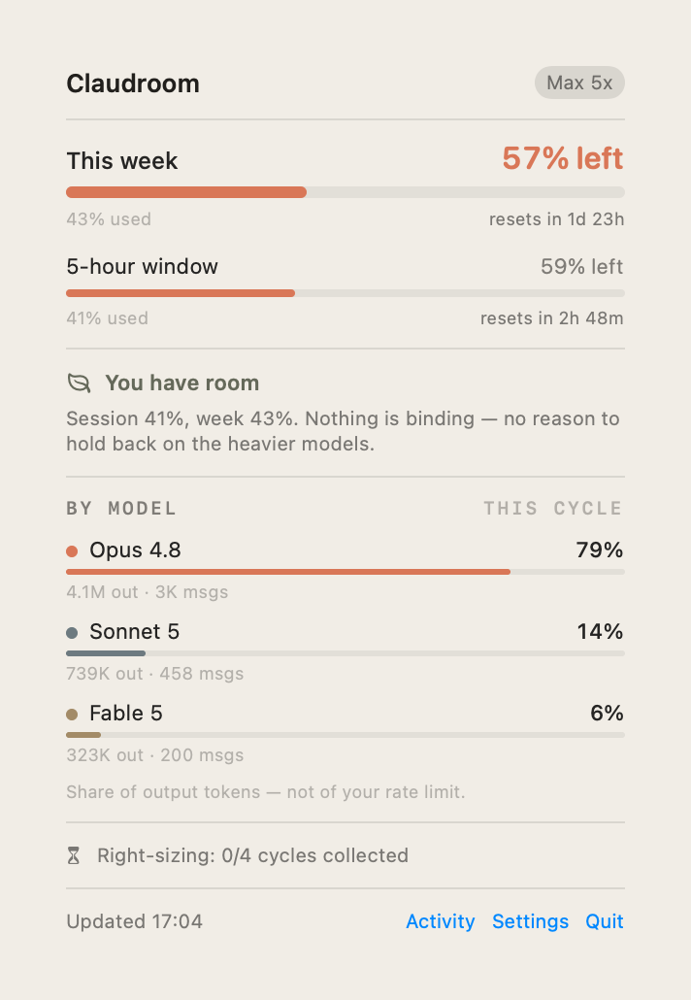
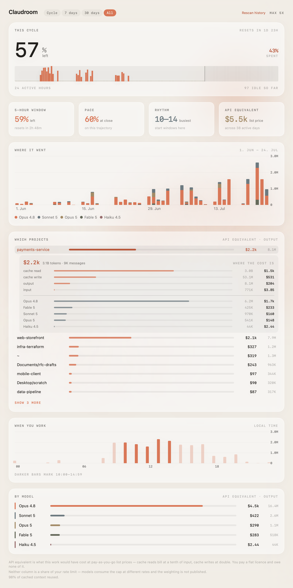

<div align="center">



# Claudroom

**A macOS menu bar app for Claude Max: how much capacity is left, where it went,
and whether you are on the right plan.**

[](https://github.com/Yassine-Kraiem/claudroom/actions/workflows/ci.yml)





</div>

## Why

Every other Claude tracker answers *"am I about to hit the limit?"*. On Max the
limit is rarely the binding constraint — unused capacity is. The weekly cycle
resets whether you touched it or not.

Claudroom measures the gap, and after four cycles says whether a cheaper plan
would have covered you.

## Install

| Requirement | |
|---|---|
| macOS | 14+. Liquid Glass needs macOS 26; below that, a translucent material. |
| Xcode | 26+ (`swift-tools-version: 6.2`). Verify with `swift --version`. |
| Claude Code | Installed and signed in. Claudroom has no login of its own. |
| Plan | Built and tested on Max 5x. Pro and Max 20x are handled but unverified. |

```bash
git clone https://github.com/Yassine-Kraiem/claudroom.git
cd claudroom
./Scripts/bundle.sh release
open Claudroom.app
```

Move `Claudroom.app` to `/Applications` and enable *Settings → Launch at login*
to keep it running.

No Apple developer certificate is required. Without one the build is ad-hoc
signed, which works — but the app's identity then changes on every rebuild, so
macOS asks for Keychain access again each time. If you have a certificate the
script finds it automatically, or you can name one with
`CLAUDROOM_SIGN_IDENTITY="Apple Development: …"`.

## First run

1. **Allow Keychain access.** Choose *Always Allow*. Nothing works until this is
   granted — the menu bar sits at `—`.
2. **Allow notifications**, or alerts never arrive. *Settings → Test
   notification* confirms delivery either way.
3. **Load full history.** Open *Activity* and press it once. Routine scans only
   read transcripts touched since the current cycle began.
4. **Right-sizing shows `0/4 cycles`** for about a month. It needs four complete
   cycles before offering a verdict.

Data lives in `~/Library/Application Support/Claudroom/usage.sqlite`. To remove
Claudroom: quit it, delete the `.app`, delete that folder.

## What it shows

- **Capacity left** on both limiters — the weekly cap and the 5-hour window. The
  menu bar always reports the **5-hour session**; weekly lives in the popover.
- **Per-model split**, read from Claude Code's transcripts. The API exposes only
  one scoped model and nulls the rest.
- **Per-project split** — which projects consumed the capacity, attributed from
  each record's `cwd` and rolled up to the project root.
- **API-equivalent cost**, per project and per model — what the same work would
  have cost on metered pay-as-you-go. Claude Code's `/usage` gives you a session
  total; this gives you the same figure sliced by project across all history.
  **Click any project** to open its breakdown: cost by token class and by model,
  which is where the cache-read share becomes obvious.
- **Session advice** naming which limiter is actually binding.
- **Waste alerts** at 48h and 24h before a cycle closes under-used; **session
  alerts** at 80% and 90% of the 5-hour window, and when it runs out. Each fires
  once per window, and a jump past both thresholds sends only the higher one.
- **Activity dashboard** — the cycle hour by hour, daily output by model, an
  hour-of-day profile, and cycle pace. A **range filter** (cycle / 7 days /
  30 days / all) governs every panel at once, so the cost, the chart and the
  project ranking always describe the same span.
- **Right-sizing** — stay, downgrade or upgrade, judged on peak rather than mean,
  with an 80% safety margin.

### Two limiters, opposite fixes

They constrain different things and can bind independently. The diagnosis is the
useful part:

| 5-hour | Weekly | Diagnosis | Action |
|---|---|---|---|
| capping | low | Rate-limited, not plan-limited | Downshift routine work; a bigger plan would not help |
| capping | high | At the plan ceiling | Genuine demand for more capacity |
| low | low | Paying for capacity you are not using | No reason to hold back |
| low | high | Front-loaded earlier in the week | Pace what is left |

## How it works

Polls two undocumented Anthropic OAuth endpoints (`/api/oauth/usage`,
`/api/oauth/profile`) with the Claude Code token and persists a time series
locally. Anthropic returns only a live snapshot with no history, so the local
series is what makes pace and right-sizing possible at all.

Polling is free — these are account-metadata endpoints that run no inference and
do not touch your rate limits.

## Design notes

**Waste is measured only against the weekly cap.** A week holds 33.6 five-hour
windows and nobody uses them all; counting unused windows as waste would report
~88% waste permanently.

**Reset timestamps are normalised to the minute.** The server recomputes
`resets_at` per request, so one cycle arrives as `11:59:59.316Z`,
`12:00:00.135Z`, `12:00:00.147Z`. Cycle identity is that timestamp, so without
normalising, every poll looks like a new cycle and right-sizing draws verdicts
from fabricated history. Regression tests cover it.

**The menu bar mark is the app icon, drawn live.** The icon was always a capacity
ring — bright arc for what is left, dim arc for what is spent — so rather than
sitting there as a static badge it is driven by the same session figure the number
reports. Colour is load-bearing, so it is deliberately not a template image: menu
bar tinting would flatten both arcs to one shade and destroy the only thing the
mark says. Its greys are fixed rather than `labelColor`, since a dynamic colour
resolves when the image is *drawn* and the menu bar caches it — which strands a
light-mode track on a dark bar.

**The menu bar number is always the 5-hour session.** It used to switch between
the session and the week depending on which was interesting, with the icon
signalling which — but that made the figure ambiguous at a glance: 54% could mean
half a week or half a session. One slot, one meaning. Weekly capacity moved to the
popover, except for the one weekly condition worth interrupting for — a cycle
closing under-used takes the icon, while the number still reports the session.

**Model share is share of output tokens, not of your rate limit.** Models consume
the cap at different rates and the weighting is not published.

**Projects are attributed from `cwd`, not the transcript folder name.** That
folder encodes the path with separators replaced, so a directory containing a
hyphen or underscore cannot be recovered from it. Paths are rolled up to the
project root, since `cwd` changes as you move around inside a session and would
otherwise fragment one project across every directory visited.

**The Keychain prompt only ever appears because you asked for it.** Claude Code
rewrites its credential item whenever it refreshes its token, and the rewrite drops
Claudroom from that item's ACL — so *Always Allow* genuinely does not stick, and
authorisation is needed again every few hours. Claudroom keeps its own copy of the
token to make that rare, but a copy still expires. The part that matters is *when*
the request happens: background polls pass `kSecUseAuthenticationUISkip`, so they
fail with `errSecInteractionNotAllowed` rather than putting a password dialog over
whatever you were doing for an app you were not looking at. The popover shows
*Keychain access needed* instead, and the dialog appears only when you press
*Reconnect*.

**Claude Code's credential is read-only and no token is ever refreshed.**
Refreshing could rotate the token and log you out of Claude Code. Claudroom does
write one item of its own — a private copy of the access token — because Claude
Code resets its item's ACL on every refresh, which is what causes repeated
authorisation prompts. *Settings → Forget stored credential* deletes the copy.

**Never a confident number from absent data.** Schema drift, stale data or an
unrecognised plan suppress the affected figure and say why.

**Two money questions; only one of them is answerable.** Converting *unused
capacity* into money was removed — a flat monthly licence is not metered billing,
so allocating a slice of the fee to each cycle invented a number. API-equivalent
cost is the other question and a measured one: exact token counts from the
transcripts against published list prices. It is what the work would have cost on
pay-as-you-go, not a bill, and nothing here is owed.

**Cache tokens dominate the cost, so their multipliers had to be right.** Neither
cache class is priced independently — writes bill at 2× the input rate and reads
at 0.1×. Cache reads are ~98% of all tokens, which makes the write multiplier the
single largest source of error: the five-minute TTL (1.25×) instead of the
one-hour (2×) lands 13% low. Both multipliers are pinned by a regression test to
a real Claude Code `/usage` readout — 5.1k input, 481.2k output, 142.7M cache
read, 4.0M cache write, reported at $123.74, reproduced at $123.41. A model with
no published price on file is reported as unpriced rather than as free.

**Zero dependencies.** System SQLite3 and Swift Charts, nothing from SPM.

### Scanning a gigabyte cheaply

The transcript corpus runs to ~1 GB across ~950 files. Files unchanged since the
last scan are skipped from metadata alone; files untouched since the cycle began
are never opened; large active files are entered by binary search on their
timestamps. A full backfill of 57 days takes about 35 seconds.

## Troubleshooting

| Symptom | Cause |
|---|---|
| Menu bar shows `—` | Cannot read the credential. Run `claude` once, then relaunch. |
| "Keychain access needed" in the popover | Claude Code refreshed its token, which drops Claudroom from its item's ACL. Press *Reconnect*. Claudroom never asks from a background poll, so this waits for you rather than interrupting. |
| Prompt on every rebuild | No code-signing identity, so the app is ad-hoc signed and its identity changes each build. |
| "Rate limited — backing off" | The usage endpoint's own anti-hammering limit, separate from your plan. Clears in minutes. |
| Charts empty after loading history | Only first-party Claude models are counted; third-party and `<synthetic>` are excluded. |

## Development

```bash
swift test                                              # 213 tests, no network, no Keychain
./Scripts/bundle.sh release                             # build Claudroom.app
swift run ClaudroomShot docs/screenshot.png --demo             # popover image
swift run ClaudroomShot docs/dashboard.png --dashboard --demo  # dashboard image
swift run ClaudroomShot build/glyphs.png --glyphs              # menu bar mark, every state
swift run ClaudroomShot --backfill                      # run the historical backfill
swift Scripts/make-icon.swift build/Claudroom.iconset   # regenerate the icon
```

| Target | Contains |
|---|---|
| `ClaudroomCore` | Decoding, storage, cycle tracking, analytics. Pure and fully tested. |
| `ClaudroomUI` | `AppModel`, design system, SwiftUI views. |
| `ClaudroomApp` | The `@main` menu bar entry point. |
| `ClaudroomShot` | Renders the real views to PNG for documentation. |

The screenshots above are rendered from **synthetic data** (`--demo`), not from a
real database — otherwise the README would publish whoever generated it: their
project names, working hours and spend, refreshed on every layout change. The
generator is seeded, so re-rendering after a design change produces a diff of the
design rather than of the noise. Drop `--demo` to render your own install.

`ClaudroomCore` never calls `Date()` inside its logic — every time-dependent
function takes an explicit `now`, which is what makes cycle rollover, gaps
spanning a reset, and alert windows testable.


## Caveats

- The endpoints are undocumented and may change without notice.
- Plan multipliers (5x, 20x) are Anthropic's plan names, not a published capacity
  ratio.
- Cycles that close while the Mac is asleep are marked `inferred`.

## Licence

[MIT](LICENSE) © 2026 Yassine Kraiem

Not affiliated with, endorsed by, or supported by Anthropic. The palette follows
the Claude ecosystem's conventions; the mark is original.
